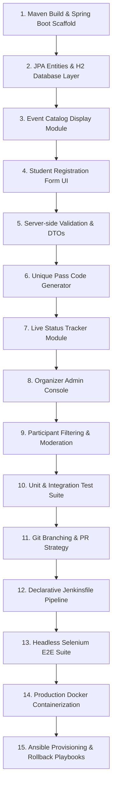

# Milestone 1: Problem Definition and Scope

**Student:** 23102A0003 — SIDDHESH RAJGURE  
**Project Title:** Jenkins-Based College Event Registration Platform

---

## 1. Real-Time Need Analysis
Modern educational institutions host numerous technical symposiums, hackathons, guest seminars, robotics competitions, and cultural festivals annually. Currently, event registration workflows suffer from significant operational bottlenecks:
- **Disparate Google Forms / Paper Submissions:** High error rates, unverified student credentials, and lack of real-time seat quota control.
- **Absence of Immediate Confirmation:** Students lack instant confirmation codes or digital event passes, causing confusion on event day.
- **Opaque Moderation Workflow:** Event coordinators spend hours reconciling spreadsheets manually without audit logs or real-time status tracking.
- **Manual, Slow Deployment:** Technical committees struggle with manual deployments, unversioned server files, and runtime downtime during traffic spikes.

---

## 2. Target Users & Stakeholders Matrix

| Stakeholder Group | Primary Role | Core Pain Point Addressed |
|---|---|---|
| **Students / Participants** | Register for events, view ticket status | Eliminates duplicate entries; instant digital pass generation. |
| **Faculty & Event Coordinators** | Review, approve, and reject registrations | Real-time seat allocation, capacity locking, participant rostering. |
| **System Administrators / DevOps Engineers** | Maintain server uptime, automate releases | Continuous Integration (CI), automated testing, and zero-downtime container updates. |
| **College Authorities / Deans** | Review event audit metrics | Accurate attendance figures and institutional data integrity. |

---

## 3. System Constraints
- **Technical Stack:** Java 17/22, Spring Boot 3.3.4, embedded Tomcat, in-memory/persisted H2 database.
- **CI/CD Automation:** Jenkins Declarative Pipeline with multi-stage quality gates and parameterized deployments.
- **Quality Assurance:** Selenium WebDriver automated end-to-end user journeys executed prior to artifact promotion.
- **Portability:** Multi-stage Docker containerization and Ansible configuration management for reproducible environments.
- **Performance:** Sub-200ms page response times, sub-60s full CI build and test execution cycle.

---

## 4. Measurable Success Criteria
1. **Zero Duplicate Registrations:** 100% rejection of duplicate student roll numbers for the same event.
2. **Instant Status Resolution:** Real-time lookup of registration state in < 50ms.
3. **Automated CI Quality Gate:** 100% automated passing of unit, integration, and Selenium tests before binary packaging.
4. **Reproducible Deployments:** Single-command container deployment via Docker and Ansible with zero-downtime health verification.

---

## 5. Frozen 15-Task MVP Scope

