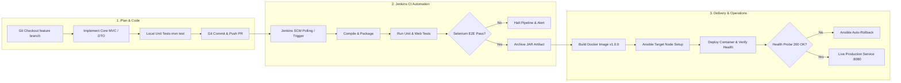

# Milestone 2: Agile Planning and DevOps Workflow

**Student:** 23102A0003 — SIDDHESH RAJGURE  
**Project Title:** Jenkins-Based College Event Registration Platform

---

## 1. User Stories & Acceptance Criteria (Gherkin Format)

### User Story 1: Event Registration
- **As a** College Student,
- **I want to** submit my name, roll number, department, and contact details for a selected event,
- **So that** I can reserve a seat and receive an immediate registration code.
- **Acceptance Criteria:**
  - *Given* I am on the `/register` page and select an open event,
  - *When* I fill in all mandatory fields with valid formats and click submit,
  - *Then* I am redirected to `/confirmation` showing my unique `REG-2026-XXXXX` code and event details.

### User Story 2: Form Validation & Duplicate Prevention
- **As a** System Auditor,
- **I want to** reject invalid student inputs and prevent duplicate registrations by roll number,
- **So that** event capacity is protected from spam or accidental double submissions.
- **Acceptance Criteria:**
  - *Given* a student attempts to submit an empty form or invalid email/phone,
  - *When* they submit the form,
  - *Then* the form highlights the exact erroneous fields and does not persist data.
  - *Given* a student with roll number `23102A0003` is already registered for Hackathon 2026,
  - *When* another registration is attempted with `23102A0003` for the same event,
  - *Then* the application displays an error message: "Student with Roll Number 23102A0003 is already registered for this event."

### User Story 3: Participant Status Tracking
- **As a** Registered Student,
- **I want to** query my registration status using my registration code or roll number,
- **So that** I know whether my participation has been confirmed or is pending review.
- **Acceptance Criteria:**
  - *Given* I visit `/status` and enter `23102A0003`,
  - *When* I click "Track Status",
  - *Then* the system renders my registration record, current status (`APPROVED`/`PENDING`), and coordinator remarks.

### User Story 4: Admin Moderation & Capacity Management
- **As an** Event Coordinator,
- **I want to** view registered participants and approve or reject submissions in real time,
- **So that** event seat quotas and student eligibility are accurately moderated.
- **Acceptance Criteria:**
  - *Given* an organizer is on `/admin`,
  - *When* they click "Approve" on a pending entry,
  - *Then* the participant status transitions to `APPROVED` and remarks are recorded.
  - *When* they click "Reject",
  - *Then* the status transitions to `REJECTED` and the event registration count is decremented.

---

## 2. 15-Task Kanban Sprint Board

| Backlog | In Progress | In Testing | Done (Verified in CI) |
|---|---|---|---|
| • Role-based OAuth (Future) • SMS notification gateway | • Multi-cluster Kubernetes helm chart | • Ansible Idempotency verification • Rollback playbook testing | • 1. Maven build setup • 2. JPA models & H2 DB • 3. Event catalog page • 4. Registration UI • 5. Input validation • 6. Pass code generator • 7. Status tracking • 8. Admin console • 9. Moderation filters • 10. JUnit 5 test suite • 11. Git branching/PRs • 12. Jenkinsfile CI pipeline • 13. Selenium E2E suite • 14. Docker multi-stage • 15. Ansible playbooks |

---

## 3. Definition of Done (DoD)
A user story or task is marked **DONE** only when:
1. Code follows clean architecture and passes static analysis without syntax warnings.
2. 100% of unit tests pass with zero regressions (`mvn test`).
3. Automated Selenium WebDriver journeys execute successfully in headless mode.
4. Jenkins CI pipeline successfully builds, archives the JAR artifact, and records passing JUnit test reports.
5. Docker image builds cleanly with non-root security principles.
6. Documentation and release notes are updated.

---

## 4. End-to-End DevOps Lifecycle Workflow

