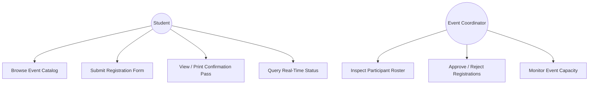
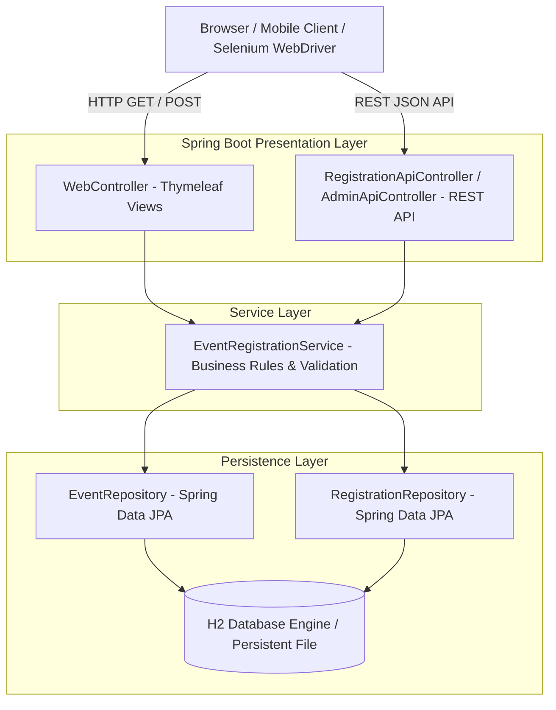
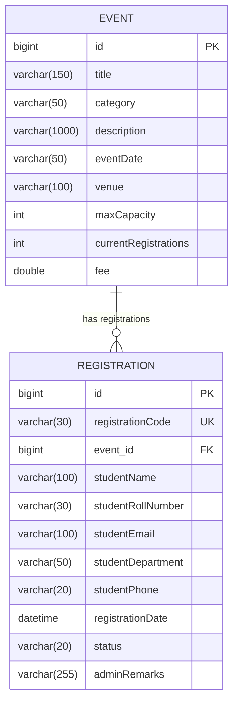

# Milestone 3: Requirements, Architecture and Technology Setup

**Student:** 23102A0003 — SIDDHESH RAJGURE  
**Project Title:** Jenkins-Based College Event Registration Platform

---

## 1. Software Requirements Specification (SRS) Summary

### Functional Requirements:
- **FR-1 (Event Showcase):** Display available events with category tags, seat quota progress bars, and pricing.
- **FR-2 (Student Registration):** Collect full name, roll number, email, branch, and phone number with client and server-side validation.
- **FR-3 (Duplicate & Capacity Guard):** Reject duplicate roll numbers for the same event and prevent overbooking when capacity is reached.
- **FR-4 (Pass Code Generation):** Generate an cryptographically randomized code formatted as `REG-YYYY-XXXXX`.
- **FR-5 (Status Tracking):** Provide single-query status verification by Registration Code or Roll Number.
- **FR-6 (Admin Moderation):** Allow event organizers to filter by event or status and trigger instant approvals or rejections.

### Non-Functional Requirements:
- **NFR-1 (Performance):** Page rendering under 250ms; API latency under 50ms.
- **NFR-2 (Scalability):** Stateless application architecture suited for horizontal replication across containers.
- **NFR-3 (Reliability & DevOps):** Automated health monitoring via `/actuator/health`; zero downtime updates via Docker containerization.

---

## 2. Use-Case Diagram



---

## 3. High-Level Component Architecture Diagram



---

## 4. Entity-Relationship Data Model



---

## 5. REST API Catalogue

| Method | Endpoint | Description | Sample Request / Response |
|---|---|---|---|
| `GET` | `/api/events` | List all active college events | `200 OK` `[{"id":1,"title":"...","category":"Technical"}]` |
| `GET` | `/api/events/{id}` | Retrieve specific event details | `200 OK` `{"id":1,"title":"...","maxCapacity":120}` |
| `POST` | `/api/registrations` | Register student for an event | `201 CREATED` Payload: `{"eventId":1,"studentName":"...","studentRollNumber":"23102A0003"}` |
| `GET` | `/api/registrations/{code}` | Retrieve registration by unique code | `200 OK` `{"registrationCode":"REG-2026-SR001","status":"APPROVED"}` |
| `GET` | `/api/registrations/search?roll=...` | Search registrations by roll number | `200 OK` List of matching registration records |
| `PATCH` | `/api/admin/registrations/{id}/status` | Update approval status & remarks | `200 OK` Payload: `{"status":"APPROVED","adminRemarks":"Verified"}` |
| `GET` | `/actuator/health` | Spring Boot Actuator Health Probe | `200 OK` `{"status":"UP"}` |

---

## 6. Working Local Setup Instructions

```bash
# 1. Clone repository
git clone https://github.com/siddheshrajgure/college-event-registration-platform.git
cd college-event-registration-platform

# 2. Compile and run test suite
./mvnw clean test

# 3. Launch application locally
./mvnw spring-boot:run

# 4. Open in browser:
# Web Portal:       http://localhost:8080/
# Admin Dashboard:  http://localhost:8080/admin
# H2 DB Console:    http://localhost:8080/h2-console (JDBC URL: jdbc:h2:mem:eventregdb, User: sa, Pass: [empty])
# Actuator Health:  http://localhost:8080/actuator/health
```
