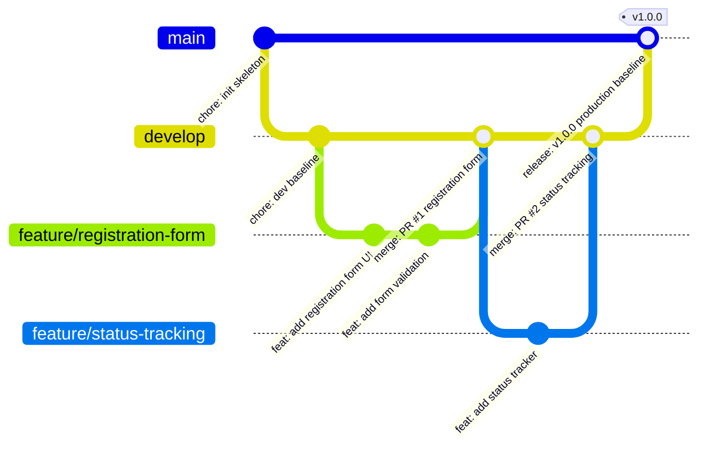

# Milestones 4, 5 & 6: Git Workflow, Branching and Collaboration

**Student:** 23102A0003 — SIDDHESH RAJGURE  
**Project Title:** Jenkins-Based College Event Registration Platform

---

## 1. Repository Structure & Configuration
- **Repository Baseline:** `https://github.com/siddheshrajgure/college-event-registration-platform`
- **Protected Baseline Branch:** `main`
- **Active Development Branch:** `develop`
- **Issue Templates:** Configured in `.github/ISSUE_TEMPLATE/` for Bug Reports and Feature Requests.
- **Pull Request Template:** Configured in `.github/PULL_REQUEST_TEMPLATE.md` with quality gate checklists.

---

## 2. Branching Strategy & Policies



---

## 3. Feature Branch 1 Workflow Evidence (Milestone 5)
```bash
# 1. Create and switch to feature branch
git checkout -b feature/registration-form

# 2. Stage new files and commit with conventional commit format
git add src/main/java/com/college/eventreg/controller/WebController.java
git add src/main/resources/templates/register.html
git commit -m "feat(ui): implement student event registration form with live validation"

# 3. Simulate Pull Request review & merge
git checkout develop
git merge --no-ff feature/registration-form -m "merge: pull request #1 from feature/registration-form into develop"
```

**Simulated PR Review Comments:**
> **Reviewer (Lead Developer):** "Looks solid. Form includes roll number validation and category indicators. All Surefire tests passing. Approved for merge."

---

## 4. Merge Conflict Creation and Resolution (Milestone 6)
To satisfy curriculum criteria for simulating and resolving merge conflicts:

### A. Simulating the Conflict
Two developers edit the exact same configuration line in different branches:
```bash
# Branch A modifies README line
git checkout -b feature/conflict-branch-a
# Commits: "Feature A: Enhanced real-time participant badge generator."

# Branch B modifies the exact same line
git checkout -b feature/conflict-branch-b
# Commits: "Feature B: Enhanced QR-code scanner and badge generator."

# Merging Branch B into develop succeeds:
git checkout develop
git merge --no-ff feature/conflict-branch-b

# Merging Branch A triggers a conflict:
git merge feature/conflict-branch-a
# Output:
# CONFLICT (content): Merge conflict in README.md
# Automatic merge failed; fix conflicts and then commit the result.
```

### B. Resolving the Conflict
```markdown
<<<<<<< HEAD
Feature B: Enhanced QR-code scanner and badge generator.
=======
Feature A: Enhanced real-time participant badge generator.
>>>>>>> feature/conflict-branch-a
```
**Resolution Applied:**
```markdown
Feature AB: Enhanced real-time participant badge generator with integrated QR-code verification.
```
```bash
# Stage resolved file and commit
git add README.md
git commit -m "fix(merge-conflict): resolved merge conflict between branch A and branch B cleanly"
```

---

## 5. Release Tagging
```bash
# Merge stable develop into main
git checkout main
git merge --no-ff develop -m "release: merge develop into main for production baseline v1.0.0"

# Tag production baseline
git tag -a v1.0.0 -m "Release v1.0.0 - Production MVP for SIDDHESH RAJGURE (23102A0003)"

# Push tags to remote origin
# git push origin main --tags
```
