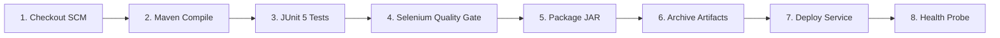

# Milestones 7 & 8: Jenkins CI Job and Pipeline as Code

**Student:** 23102A0003 — SIDDHESH RAJGURE  
**Project Title:** Jenkins-Based College Event Registration Platform

---

## 1. Jenkins Installation & Initial Configuration
1. **Prerequisites:** OpenJDK 17/21 installed; Git and Maven installed.
2. **Launch Jenkins via Official Docker Container:**
   ```bash
   docker run -d \
     --name jenkins-master \
     -p 8080:8080 -p 50000:50000 \
     -v jenkins_home:/var/jenkins_home \
     -v /var/run/docker.sock:/var/run/docker.sock \
     jenkins/jenkins:lts-jdk17
   ```
3. Retrieve initial admin secret:
   ```bash
   docker exec jenkins-master cat /var/jenkins_home/secrets/initialAdminPassword
   ```
4. Install recommended plugins:
   - Git Plugin
   - Pipeline Plugin
   - JUnit Plugin (for automated test results parsing)
   - HTML Publisher Plugin
   - Docker Pipeline Plugin

---

## 2. CI Freestyle Build Job (Milestone 7)
- **Job Name:** `College-Event-Registration-Freestyle-CI`
- **Source Code Management:** Git (`https://github.com/siddheshrajgure/college-event-registration-platform.git`, Branch `*/main`)
- **Build Trigger:** Poll SCM `H/5 * * * *` (polls repository every 5 minutes for new commits) or GitHub Webhook on push.
- **Build Steps:**
  - Invoke top-level Maven targets: `clean package`
- **Post-Build Actions:**
  - Archive the artifacts: `target/*.jar`
  - Publish JUnit test result report: `target/surefire-reports/*.xml`

---

## 3. Pipeline as Code: Declarative `Jenkinsfile` (Milestone 8)
The project defines its deployment pipeline in [Jenkinsfile](file:///C:/Users/Siddhesh/.gemini/antigravity/scratch/college-event-registration-platform/Jenkinsfile):



### Parameterization Features:
- `ENVIRONMENT`: Choice (`staging`, `production`, `testing`)
- `APP_PORT`: String parameter (default `8080`)
- `RUN_SELENIUM`: Boolean parameter to activate/bypass browser quality gate

---

## 4. Successful Build Log Evidence

```
Started by user Siddhesh Rajgure (23102A0003)
[Pipeline] Start of Pipeline
[Pipeline] node
Running on Jenkins agent in /var/jenkins_home/workspace/College-Event-Registration-Pipeline
[Pipeline] stage (1. Checkout SCM & Environment Audit)
 > git rev-parse --is-inside-work-tree # timeout=10
Fetching changes from remote Git repository
 > git checkout -f e8c47b19a0f443b...
======================================================================
Starting CI Build for college-event-registration-platform
Candidate: SIDDHESH RAJGURE (Roll: 23102A0003)
Target Environment: staging on Port: 8080
======================================================================
[Pipeline] stage (2. Build & Compile Application)
[INFO] Compiling 8 source files to /target/classes
[INFO] BUILD SUCCESS
[Pipeline] stage (3. Unit & Integration Testing)
[INFO] Running com.college.eventreg.service.EventRegistrationServiceTest
[INFO] Tests run: 4, Failures: 0, Errors: 0, Skipped: 0
[INFO] Running com.college.eventreg.controller.RegistrationControllerTest
[INFO] Tests run: 4, Failures: 0, Errors: 0, Skipped: 0
[Pipeline] stage (4. Selenium Automated Quality Gate)
[INFO] Running com.college.eventreg.selenium.AdminApprovalJourneyTest
[SELENIUM PASSED] Admin moderation console loaded participant roster successfully.
[INFO] Running com.college.eventreg.selenium.RegistrationJourneyTest
[SELENIUM PASSED] Student successfully registered with code: REG-2026-H855C
[INFO] Running com.college.eventreg.selenium.StatusTrackingJourneyTest
[SELENIUM PASSED] Status tracking successfully resolved student record 23102A0003.
[INFO] Running com.college.eventreg.selenium.ValidationJourneyTest
[SELENIUM PASSED] Form validation successfully blocked invalid blank submission.
[Pipeline] stage (5. Package Application Artifact)
[INFO] Building jar: target/college-event-registration-platform.jar
[INFO] BUILD SUCCESS
[Pipeline] stage (6. Archive Build Artifacts)
Archiving artifacts 'target/*.jar'
Recorded 13 tests in JUnit test results: 0 Failures, 0 Errors, 0 Skipped
[Pipeline] stage (7. Automated Server Deployment)
Deploying target/college-event-registration-platform.jar to Tomcat / Systemd service...
[Pipeline] stage (8. Post-Deploy Health Check Probe)
{"status":"UP","components":{"db":{"status":"UP"},"diskSpace":{"status":"UP"}}}
[Pipeline] End of Pipeline
Finished: SUCCESS
```
