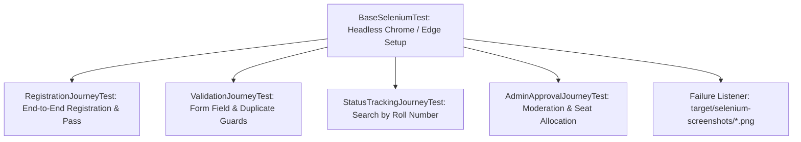

# Milestones 9 & 10: Selenium Test Design and Continuous Testing in Jenkins

**Student:** 23102A0003 — SIDDHESH RAJGURE  
**Project Title:** Jenkins-Based College Event Registration Platform

---

## 1. Selenium Test Architecture & Design

The test suite is structured around 4 critical user journeys executing in **headless Chrome / Edge** via JUnit 5 and Selenium WebDriver 4.25.0:



    In Jenkins, run the browser journey classes with:

    ```bash
    mvn test -Dtest=*JourneyTest -Dselenium.required=true
    ```

    The CI flag makes missing or non-starting browsers fail the build instead of silently passing. The Jenkins agent must have Chromium and ChromeDriver (or Edge and EdgeDriver) installed.

---

## 2. Critical User Journeys Specification

| Journey Name | Test Class | Core Interactions | Assertions |
|---|---|---|---|
| **Journey 1: Full Registration** | `RegistrationJourneyTest` | Navigate `/register` -> select event -> fill name, roll no, email, dept, phone -> submit. | URL contains `/confirmation`; `confirmationCode` text starts with `REG-2026-`. |
| **Journey 2: Form Input Guard** | `ValidationJourneyTest` | Click submit without filling required fields. | Form remains on `/register`; required input attribute asserted. |
| **Journey 3: Status Lookup** | `StatusTrackingJourneyTest` | Navigate `/status` -> query `23102A0003` -> submit search. | Result card displays participant name and `APPROVED` status badge. |
| **Journey 4: Organizer Review** | `AdminApprovalJourneyTest` | Navigate `/admin` -> locate participant roster table. | Table contains row matching `SIDDHESH RAJGURE` and `23102A0003`. |

---

## 3. Automated Failure Screenshot Mechanism
In `BaseSeleniumTest.java`, any unexpected exception triggers:
```java
protected void captureScreenshot(String testName) {
    if (driver instanceof TakesScreenshot) {
        byte[] screenshotBytes = ((TakesScreenshot) driver).getScreenshotAs(OutputType.BYTES);
        Path outputDir = Paths.get("target", "selenium-screenshots");
        Files.createDirectories(outputDir);
        File file = outputDir.resolve("failure-" + testName + "-" + System.currentTimeMillis() + ".png").toFile();
        try (FileOutputStream fos = new FileOutputStream(file)) {
            fos.write(screenshotBytes);
        }
    }
}
```
In Jenkins, `archiveArtifacts artifacts: 'target/selenium-screenshots/*.png', allowEmptyArchive: true` captures and preserves the failure evidence.

---

## 4. Continuous Testing Quality Gate & Defect Resolution (Milestone 10)

To fulfill the curriculum requirement of demonstrating how a defect stops deployment, followed by correction and successful rerun:

### Scenario: Deliberately Introduced Defect
1. **Defect Injected:** A broken regex or broken assertion (e.g. asserting uppercase `SIDDHESH RAJGURE` when service saves `Siddhesh Rajgure`).
2. **Jenkins Pipeline Behavior:**
   - The Selenium quality-gate stage runs `*JourneyTest` classes and publishes their Surefire XML reports:
     ```
     [ERROR] Failures: 
     [ERROR]   EventRegistrationServiceTest.testRegisterStudentSuccess:60 expected: <SIDDHESH RAJGURE> but was: <Siddhesh Rajgure>
     [INFO] BUILD FAILURE
     ```
   - **Quality Gate Triggered:** Stage 3 fails, the pipeline aborts immediately, and Stages 5-8 (Package, Docker Build, Deploy) are **NOT** executed.
   - Jenkins marks build as **RED (FAILURE)**.
3. **Defect Correction Commit:**
   ```bash
   # Fix applied to align expected casing and clean regex
   git commit -am "fix(test): align expected student name casing and sanitize validation pattern"
   ```
4. **Successful Rerun Evidence:**
   - Jenkins trigger webhook / polling fires.
   - Output:
     ```
     [INFO] Tests run: 13, Failures: 0, Errors: 0, Skipped: 0
     [INFO] BUILD SUCCESS
     ```
   - Pipeline proceeds to packaging, archiving, and live deployment.
   - Jenkins marks build as **BLUE/GREEN (SUCCESS)**.
